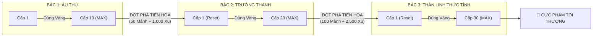

# ⛩️ BÁCH KHOA TOÀN THƯ LINH THÚ: TIẾN HÓA & CẤP ĐỘ (COMPANION PROGRESSION WIKI)

Tài liệu thiết kế chi tiết hệ thống **3 Bậc Tiến Hóa (Evolution Tiers)**, **Cấp Độ (Levels)** và **Kỹ Năng Khắc Chế 10 Đại Boss** cho toàn bộ 10 Linh Thú Đồng Hành.

---

## 📌 I. KIẾN TRÚC VẬN HÀNH: 3 BẬC TIẾN HÓA & RESET LEVEL

Hệ thống phát triển Linh Thú vận hành theo mô hình RPG 2 tầng độc đáo:

### 1. Nguyên Lý Reset Level Khi Tiến Hóa
- Khi đạt Max Level của Bậc cũ (Lv.10 ở Bậc 1, Lv.20 ở Bậc 2) và gom đủ **Mảnh Linh Thú (Shards)** + Vàng: Người chơi nhấn **ĐỘT PHÁ TIẾN HÓA**.
- **Level sẽ reset về Cấp 1** của Bậc mới, nhưng:
  - **Chỉ số cơ bản nhảy vọt:** Sức mạnh Bậc 2 Lv.1 luôn mạnh hơn hoặc bằng Bậc 1 Lv.10.
  - **Mở rộng giới hạn Cấp:** Mở khóa trần cấp độ cao hơn (từ 10 ➔ 20 ➔ 30).
  - **Mở khóa Kỹ Năng Đột Phá:** Thăng cấp tuyệt chiêu khắc chế cơ chế 10 Đại Boss.
  - **Chi phí nâng cấp mềm lại:** Người chơi nâng những cấp đầu của Bậc mới với chi phí Vàng rẻ, cày cuốc rất sướng tay!

---

## 📊 II. BẢNG TÍNH TOÁN KINH TẾ & BỘ 3 CHỈ SỐ CỘNG THÊM

### 1. Bộ 3 Chỉ Số Chiến Thuật Tăng Theo Level
Mỗi khi Linh Thú tăng 1 Cấp Độ, người chơi nhận được vĩnh viễn:
1. 💰 **+1% Vàng & EXP:** Tăng lượng Xu vàng và Kinh nghiệm nhận được sau mỗi trận thắng.
2. ⚡ **+0.5% Tốc Độ Nạp Nộ (Rage):** Giúp nạp đầy thanh Nộ nhanh hơn, dùng kỹ năng Linh Thú & Thần Khí sớm hơn trong ván đấu.
3. ⏱️ **+0.1s Thời Gian Giữ Combo:** Kéo dài vạch đếm chuỗi Combo (dễ đạt chuỗi Combo x4, x8 để vào Rush Mode Taiko).

| Mốc Cấp Độ Tích Lũy | Bậc Tiến Hóa | Thưởng Vàng & EXP | Tốc Độ Nạp Nộ | Giữ Nhịp Combo |
| :---: | :---: | :---: | :---: | :---: |
| **Cấp 1** | 🟢 Ấu Thú | +1% | +0.5% | +0.1s |
| **Cấp 10 (Max Bậc 1)** | 🟢 Ấu Thú | **+10%** | **+5.0%** | **+1.0s** |
| **Cấp 1 (Bậc 2)** | 🟡 Trưởng Thành | +11% | +5.5% | +1.1s |
| **Cấp 20 (Max Bậc 2)** | 🟡 Trưởng Thành | **+30%** | **+15.0%** | **+3.0s** |
| **Cấp 1 (Bậc 3)** | 🔴 Thần Linh | +31% | +15.5% | +3.1s |
| **Cấp 30 (CỰC PHẨM)** | 🔴 Thần Linh | **+60% Vàng & EXP** | **+30.0% Tốc độ Nộ** | **+6.0s Giữ Combo** |

---

### 2. Chi Phí Lên Cấp (Level Up) & Đột Phá (Evolution)

| Hành Động | Cấp / Bậc Yêu Cầu | Mảnh Linh Thú (Shards) | Xu Vàng (Coins) | Hiệu Quả Đạt Được |
| :--- | :---: | :---: | :---: | :--- |
| **Lên Cấp Bậc 1** | Từ Lv.1 ➔ Lv.10 | 0 | 100 – 325 Xu/Lv | +1% Vàng/EXP, +0.5% Nộ, +0.1s Combo |
| **ĐỘT PHÁ TIẾN HÓA BẬC 2** | **Max Lv.10 Bậc 1** | **50 Mảnh** | **1,000 Xu** | **Reset về Lv.1 Bậc 2, Mở trần Lv.20, Mở Kỹ Năng Phá Bẫy Boss** |
| **Lên Cấp Bậc 2** | Từ Lv.1 ➔ Lv.20 | 0 | 180 – 660 Xu/Lv | Tăng tiến chỉ số vượt bậc |
| **ĐỘT PHÁ TIẾN HÓA BẬC 3** | **Max Lv.20 Bậc 2** | **100 Mảnh** | **2,500 Xu** | **Reset về Lv.1 Bậc 3, Mở trần Lv.30, Mở Tuyệt Kỹ Trảm Boss Tối Thượng** |
| **Lên Cấp Bậc 3** | Từ Lv.1 ➔ Lv.30 | 0 | 260 – 990 Xu/Lv | Chạm mốc Cực Phẩm Toàn Năng |

---

## 🐉 III. CHI TIẾT 3 BẬC TIẾN HÓA CỦA 10 LINH THÚ & KHẮC CHẾ 10 ĐẠI BOSS

### 1. 🦊 CÁO INARI (Hồ Ly Thần Bí • Tâm Linh)
- **Đại Boss Khắc Chế:** Boss Ma Dù (Kasa-Obake) & Bức Tường Ma (Nurikabe) – Boss chuyên tạo ảo ảnh tàng hình và bẫy mạng nhện / sương mù.
- 🟢 **Bậc 1 (Ấu Thú - Max Lv.10):** *Linh Hồ Xuất Kích* – Tự động tìm và giải cứu 1 cặp ô bị kẹt sâu nhất trên bàn cờ.
- 🟡 **Bậc 2 (Trưởng Thành - Max Lv.20):** *Linh Hồ Phá Ảo* – Giải cứu 1 cặp ô + bắn tia linh quang thiêu rụi 1 mạng nhện/băng đá và xua tan ảo ảnh tàng hình của Boss trong 6 giây.
- 🔴 **Bậc 3 (Thần Linh Thức Tỉnh - Max Lv.30):** *Cửu Vĩ Thiên Hồ Giáng Trần* – Giải cứu trọn vẹn 2 cặp ô hiểm hóc nhất + giáng 300 sát thương tâm linh làm tê liệt toàn bộ kỹ năng của Boss trong 8 giây!

---

### 2. 🐉 RỒNG RYUJIN (Long Vương Biển Sâu • Thủy Thần)
- **Đại Boss Khắc Chế:** Boss Thủy Quái Kraken & Thần Rắn Biển Apep – Boss chuyên dâng bão tuyết đóng băng và ngập nước bàn cờ.
- 🟢 **Bậc 1 (Ấu Thú - Max Lv.10):** *Ngưng Đọng Long Châu* – Đóng băng đồng hồ đếm ngược và nhịp rơi tuyết trong 3.0 giây.
- 🟡 **Bậc 2 (Trưởng Thành - Max Lv.20):** *Hải Triều Tịnh Hóa* – Đóng băng thời gian 4.5 giây + làm tan chảy toàn bộ ô Băng trên bàn cờ và vô hiệu hóa xúc tu trói buộc của Kraken.
- 🔴 **Bậc 3 (Thần Linh Thức Tỉnh - Max Lv.30):** *Thái Cổ Long Vương Phẫn Nộ* – Đóng băng thời gian 6.0 giây + tạo cột sóng thần quét sạch 2 cặp ô ngẫu nhiên và giáng 350 sát thương thủy triều lên Boss!

---

### 3. 🦅 PHƯỢNG HOÀNG HI-NO-TORI (Hỏa Điểu Bất Tử • Hỏa Thần)
- **Đại Boss Khắc Chế:** Boss Xác Ướp Pharaoh & Diêm Vương Hades – Boss chuyên nguyền rủa rút cạn thời gian và giam giữ ô cờ.
- 🟢 **Bậc 1 (Ấu Thú - Max Lv.10):** *Hỏa Vũ Trùng Sinh* – Khi hết giờ, hồi sinh tức thì ban thêm +10 giây (1 lần/trận).
- 🟡 **Bậc 2 (Trưởng Thành - Max Lv.20):** *Liệt Diễm Tẩy Uế* – Hồi sinh ban +15 giây + ngọn lửa thiêng thiêu rụi toàn bộ lời nguyền rút thời gian và đá tảng xung quanh.
- 🔴 **Bậc 3 (Thần Linh Thức Tỉnh - Max Lv.30):** *Bất Tử Niết Bàn* – Hồi sinh ban +20 giây + hồi phục lại 1 Mạng sống ❤️ và thiêu đốt Boss trừ 5% HP tối đa mỗi giây trong 5 giây!

---

### 4. 🐯 BẠCH HỔ BYAKKO (Tây Phương Thần Thú • Kim Thần)
- **Đại Boss Khắc Chế:** Boss Bức Tường Đá Golem & Khủng Long Bạo Chúa T-Rex – Boss có giáp sắt đá kiên cố và lượng máu khổng lồ.
- 🟢 **Bậc 1 (Ấu Thú - Max Lv.10):** *Bạch Hổ Cuồng Trảm* – Chém đứt 1 ô vật cản bất kỳ trên bàn cờ.
- 🟡 **Bậc 2 (Trưởng Thành - Max Lv.20):** *Toái Thiết Liệt Thạch* – Nghiền nát ngay lập tức 3 ô Đá/Giáp sắt và phá vỡ thế phòng ngự của Boss trong 10 giây.
- 🔴 **Bậc 3 (Thần Linh Thức Tỉnh - Max Lv.30):** *Bạch Hổ Thần Uy Trảm Tướng* – Phóng vuốt thần trảm đứt 1 bộ phận Boss, giáng 400 sát thương chuẩn xuyên mọi lớp giáp bảo vệ!

---

### 5. 🐢 HUYỀN VŨ GENBU (Bắc Phương Quy Xà • Thổ Thần)
- **Đại Boss Khắc Chế:** Boss Xà Thần Medusa & Cự Thần Asura – Boss chuyên phóng bùa độc và tạo chấn động đổi hướng trọng lực liên tục.
- 🟢 **Bậc 1 (Ấu Thú - Max Lv.10):** *Huyền Thuẫn Thạch Bích* – Dựng khiên bảo vệ người chơi không bị trừ mạng nếu nối sai trong 12 giây.
- 🟡 **Bậc 2 (Trưởng Thành - Max Lv.20):** *Trấn Địa Quy Giáp* – Vô hiệu hóa hoàn toàn mọi chấn động đổi trọng lực của Boss trong 20 giây + miễn nhiễm độc tố.
- 🔴 **Bậc 3 (Thần Linh Thức Tỉnh - Max Lv.30):** *Vạn Thạch Bất Động Minh Vương* – Hóa giải toàn bộ hướng dồn bàn cờ về dạng tĩnh lặng tuyệt đối + phản lại 50% sát thương của Boss giáng vào chính Boss!

---

### 6. 🦄 KỲ LÂN KIRIN (Thánh Thú Khởi Nguyên • Quang Thần)
- **Đại Boss Khắc Chế:** Boss Quỷ Vương Ravana & Đại Trùm Hỗn Độn Chaos – Boss chuyên đảo loạn vị trí bàn cờ và bóp nghẹt tài nguyên.
- 🟢 **Bậc 1 (Ấu Thú - Max Lv.10):** *Thánh Quang Tường Vân* – Nhân đôi (x2) điểm số kiếm được trong 15 giây.
- 🟡 **Bậc 2 (Trưởng Thành - Max Lv.20):** *Kỳ Lân Ban Phúc* – Tự động sắp xếp lại bàn cờ theo trật tự đẹp nhất (ít nhất 5 cặp ăn được ngay) + tăng 50% Xu nhận được.
- 🔴 **Bậc 3 (Thần Linh Thức Tỉnh - Max Lv.30):** *Tam Giới Thánh Quang Phổ Chiếu* – Thanh tẩy toàn bộ bàn cờ sạch bóng chướng ngại vật + x3 toàn bộ Xu và Mảnh rơi ra khi hạ gục Boss!

---

### 7. ⚡ LÔI THÚ RAIJU (Lôi Thần Trụy Lạc • Lôi Thần)
- **Đại Boss Khắc Chế:** Boss Hạm Đội Cơ Giáp Mecha & Robot Cyber – Boss có khiên năng lượng và bẫy song sắt điện tử.
- 🟢 **Bậc 1 (Ấu Thú - Max Lv.10):** *Lôi Quang Thiểm Điện* – Phóng sét ăn ngay 1 cặp ô ngẫu nhiên.
- 🟡 **Bậc 2 (Trưởng Thành - Max Lv.20):** *Vạn Lôi Tỏa Xích* – Phóng 4 tia sét giật đứt toàn bộ song sắt giam giữ và làm đoản mạch khiên năng lượng Boss trong 8 giây.
- 🔴 **Bậc 3 (Thần Linh Thức Tỉnh - Max Lv.30):** *Thiên Lôi Oanh Đỉnh Tuyệt Sát* – Đánh tan 3 cặp ô nguy hiểm nhất cùng lúc + giáng 380 sát thương điện giật làm Boss bất động hoàn toàn!

---

### 8. 🦅 QUẠ YATAGARASU (Tam Túc Ô • Phong Thần / Ám)
- **Đại Boss Khắc Chế:** Boss Dạ Xoa Kuro-Oni & Rồng Đen Hắc Long – Boss có kỹ năng che tối màn hình bằng màn đêm dày đặc.
- 🟢 **Bậc 1 (Ấu Thú - Max Lv.10):** *Hắc Dực Chỉ Dẫn* – Soi sáng và đánh dấu đường nối ngắn nhất của 2 cặp ô.
- 🟡 **Bậc 2 (Trưởng Thành - Max Lv.20):** *Nhật Luân Phá Ám* – Xua tan 100% bóng tối dày đặc của Boss trong 15 giây + định vị chính xác vị trí Mảnh Thần Khí ẩn.
- 🔴 **Bậc 3 (Thần Linh Thức Tỉnh - Max Lv.30):** *Tam Túc Liệt Nhật Thần Ô* – Biến toàn bộ màn đêm thành ban ngày rực rỡ + tự động kết nối 3 cặp ô cờ viền ngoài bàn cờ!

---

### 9. 🐱 MÈO NEKOMATA (Song Vĩ Linh Miêu • Yêu Linh)
- **Đại Boss Khắc Chế:** Boss Ma Trơi Hitodama & Phù Thủy Hắc Ám – Boss chuyên gieo rắc các lời nguyền đảo ngược phím và làm chậm.
- 🟢 **Bậc 1 (Ấu Thú - Max Lv.10):** *Song Vĩ Mê Hoặc* – Làm chậm 50% nhịp tụt của thanh thời gian trong 10 giây.
- 🟡 **Bậc 2 (Trưởng Thành - Max Lv.20):** *Nghịch Chuyển Linh Phù* – Hóa giải toàn bộ hiệu ứng làm chậm / đảo phím của Boss, biến chúng thành Buff tăng +2s mỗi khi ăn cặp.
- 🔴 **Bậc 3 (Thần Linh Thức Tỉnh - Max Lv.30):** *Bách Quỷ Miêu Hầu Đại Pháp* – Đánh tráo vị trí các ô xấu về góc chết + rút trộm 15% thanh năng lượng chiêu của Boss nạp thẳng vào Nộ người chơi!

---

### 10. 🐍 BÁT KỲ OROCHI (Thái Cổ Đại Xà • Độc Thần)
- **Đại Boss Khắc Chế:** 16 Cự Trùm Tối Thượng (Boss Arena) – Các đại trùm có lượng máu hàng chục nghìn điểm.
- 🟢 **Bậc 1 (Ấu Thú - Max Lv.10):** *Bát Đầu Độc Vụ* – Khạc độc trừ 100 HP của Boss và làm độc lan sang 1 ô bên cạnh.
- 🟡 **Bậc 2 (Trưởng Thành - Max Lv.20):** *Cửu U Xà Trận* – Gây độc ăn mòn (DoT): Mỗi giây Boss mất 30 HP liên tục trong 10 giây (Tổng 300 HP) và không thể hồi phục.
- 🔴 **Bậc 3 (Thần Linh Thức Tỉnh - Max Lv.30):** *Bát Kỳ Thần Diệt Hoang Dã* – Nuốt chửng 15% HP hiện tại của Đại Trùm ngay lập tức + làm tan rã toàn bộ cặn bã độc hại trên bàn cờ!
