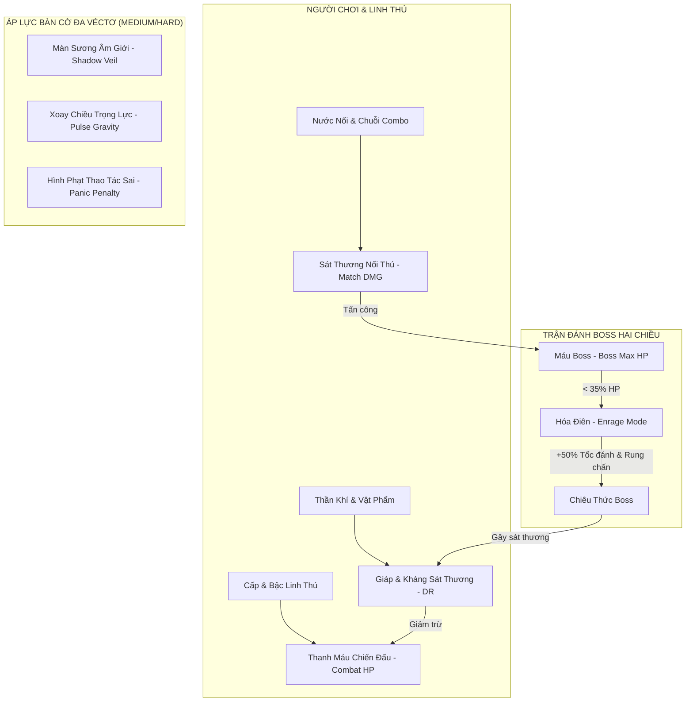

# Wiki Thuật Toán: Hệ Thống Chiến Đấu RPG & Bộ Máy Độ Khó Thích Ứng (Combat & Adaptive Difficulty Engine Wiki)

> **Dự án**: Foxy Pair — Nối Thú Cổ Điển & Thần Thoại Vạn Giới (Yokai Onet)  
> **Kiến trúc tham chiếu**: ADR 0015 (`docs/adr/0015-rpg-combat-and-adaptive-difficulty-engine.md`)  
> **Phiên bản tài liệu**: v1.0.0 — Canonical Specification  

---

## 1. Tổng Quan & Bối Cảnh Bài Toán (Problem Statement)

### 1.1. Lỗ hổng của cơ chế Onet truyền thống đối với người chơi kỹ năng cao
Trong game nối thú (Onet / Pikachu) cổ điển, khi người chơi sở hữu mắt quét nhanh (peripheral vision) và tốc độ tay cao (high APM):
- **Bàn cờ tĩnh** khiến người chơi nhanh chóng ghi nhớ vị trí các cặp ô ngoài rìa và giải quyết bàn cờ chỉ trong vài chục giây.
- **Boss không tấn công thực tế**: Trước đây, Boss chỉ xuất hiện với thanh máu và thi thoảng rải vật cản (băng, đá). Người chơi có thể hoàn toàn "phớt lờ" Boss, chỉ cần tập trung nối nhanh là Boss tự chết theo đợt dọn bàn.
- **Cơ chế RPG bị tách rời**: Người chơi không có động lực sống còn để nâng cấp Linh Thú hay săn tìm Thần Khí phòng thủ, vì dù Linh Thú cấp 1 hay cấp 10 thì nhân vật cũng không bao giờ bị Boss đánh gục.

### 1.2. Giải pháp: Hệ thống Chiến đấu Hai Chiều & Động Cơ Áp Lực Đa Véctơ
Chúng tôi xây dựng một hệ thống toán học khép kín gồm 2 trục chính:
1. **Trục Chiến Đấu RPG Hai Chiều (Bidirectional Combat Loop)**: Boss sở hữu sát thương chủ động và giai đoạn Cuồng Nộ (Enrage Phase). Người chơi sở hữu thanh Máu Chiến Đấu (Combat HP) được cường hóa từ cấp bậc Linh Thú, Giáp từ Thần Khí và Vật phẩm Hộ Thể.
2. **Trục Áp Lực Đa Véctơ Cho Màn Thường (Multi-Vector Pressure Engine)**: Ở cấp độ Medium và Hard, bàn cờ không còn đứng yên. Màn sương âm giới (Shadow Veil), nhịp đổi trọng lực (Pulse Gravity Shift) và hình phạt bấm sai (Panic Penalty) buộc các cao thủ phải xử lý thế trận bằng tư duy chiến thuật thay vì phản xạ cơ học đơn thuần.

---

## 2. Mô Hình Toán Học & Công Thức Cân Bằng (Mathematical Formulation)



---

### 2.1. Công thức Máu Chiến Đấu của Người Chơi (Player Combat HP)
Thanh HP chiến đấu đại diện cho sức chịu đựng của người chơi và Linh Thú trước các đòn đánh sấm sét của Boss:

$$\text{Max HP} = \text{BaseHP} + (\text{Companion Level} \times \alpha) + (\text{Companion Tier} \times \beta) + \text{Relic HP}$$

*Trong đó*:
- $\text{BaseHP} = 1000 \text{ HP}$ (Máu cơ bản).
- $\alpha = 80 \text{ HP}$ mỗi cấp Linh Thú (Cấp 1 đến 10).
- $\beta = 250 \text{ HP}$ mỗi bậc tiến hóa Linh Thú (Bậc 1 đến 3).
- $\text{Relic HP}$: Điểm cộng dồn từ các Thần Khí phòng thủ (từ $+100$ đến $+600 \text{ HP}$).
- *Ví dụ*: Linh Thú Cáo Inari Cấp 10, Bậc 3 mang Thần Khí Thượng Phẩm sẽ có:
  $$\text{Max HP} = 1000 + (10 \times 80) + (3 \times 250) + 450 = 3000 \text{ HP}$$

---

### 2.2. Công thức Sát Thương Của Nước Nối (Match Damage Output)
Mỗi cặp nối thành công sẽ bắn luồng đạn linh lực tấn công trực diện vào Boss:

$$\text{Match DMG} = \left(\text{BaseMatch} + \frac{\text{Companion Level} \times 5}{2}\right) \times M_{\text{combo}} \times M_{\text{fever}}$$

*Trong đó*:
- $\text{BaseMatch} = 15 \text{ DMG}$.
- $M_{\text{combo}} = 1.0 + (\text{Combo Count} \times 0.15)$ (Tối đa $3.5\times$ ở Combo 16).
- $M_{\text{fever}} = 1.5$ khi người chơi đang trong trạng thái Bách Quỷ Dạ Hành (Fever Rush).
- *Ví dụ*: Ở Combo 6 với Linh Thú Cấp 6:
  $$\text{Match DMG} = \left(15 + \frac{6 \times 5}{2}\right) \times (1.0 + 6 \times 0.15) = 30 \times 1.9 = 57 \text{ DMG / cặp}$$

---

### 2.3. Công thức Co Giãn Sức Mạnh Boss (Boss Dynamic Scaling)

#### A. Máu Tối Đa Của Boss (Boss Max HP)
$$\text{Boss HP} = \text{BaseBossHP} \times \left(1 + \frac{\text{Level}}{15}\right) \times K_{\text{diff}}$$

| Độ Khó | Hệ Số $K_{\text{diff}}$ | Màn 10 (Chương 1) | Màn 50 (Chương 5) | Màn 100 (Chương 10) |
| :--- | :---: | :---: | :---: | :---: |
| **Dễ (Easy)** | $1.0\times$ | 1.000 HP | 2.600 HP | 4.600 HP |
| **Vừa (Medium)** | $1.8\times$ | 1.800 HP | 4.680 HP | 8.280 HP |
| **Khó (Hard)** | $3.0\times$ | 3.000 HP | 7.800 HP | 13.800 HP |

#### B. Sát Thương Đòn Đánh Boss (Boss Attack Damage)
$$\text{Boss DMG} = \text{BaseAttack} \times \left(1 + \frac{\text{Level}}{20}\right) \times D_{\text{diff}}$$

*Trong đó*:
- $\text{BaseAttack} = 120 \text{ DMG}$.
- $D_{\text{diff}}$: Easy = $1.0\times$, Medium = $1.5\times$, Hard = $2.2\times$.
- *Thời gian hồi chiêu giữa các đòn đánh* ($T_{\text{cooldown}}$):
  - Easy: $7.0\text{s}$
  - Medium: $4.5\text{s}$
  - Hard: $3.0\text{s}$

#### C. Giai Đoạn Cuồng Nộ (Enrage / Berserk Phase)
Khi máu Boss giảm xuống dưới ngưỡng $\mathbf{35\%}$:
- Tốc độ tấn công tăng vọt: $T_{\text{berserk}} = T_{\text{cooldown}} \times 0.5$ (Ở Hard, Boss giáng đòn mỗi $1.5\text{s}$).
- Mỗi đòn đánh trong trạng thái Cuồng Nộ khóa cứng 2 ô ngẫu nhiên trong $3\text{s}$ hoặc kích hoạt chấn động rung lắc màn hình (Screen Shake).

---

### 2.4. Công thức Giảm Trừ Sát Thương (Damage Mitigation)
Người chơi giảm bớt lượng sát thương nhận vào nhờ đặc tính phòng ngự của Linh Thú và Thần Khí:

$$\text{Damage Received} = \text{Boss DMG} \times (1 - \text{DR}_{\text{companion}} - \text{DR}_{\text{relic}})$$

- $\text{DR}_{\text{companion}}$: Tối đa 25% (Linh Thú Huyền Vũ Genbu hoặc Bạch Hổ Byakko).
- $\text{DR}_{\text{relic}}$: Tối đa 20% (Thần Khí Quy Giáp / Khiên Thần).
- *Trần giảm sát thương (Hard Cap)*: Không vượt quá $60\%$ tổng sát thương.

---

## 3. Bộ Máy Áp Lực Đa Véctơ Cho Màn Thường (Non-Boss Multi-Vector Engine)

Nhằm ngăn chặn tình trạng "game quá dễ khi người chơi có kỹ năng Onet đỉnh cao", ba thuật toán động sau được kích hoạt ở cấp độ **Vừa (Medium)** và **Khó (Hard)**:

### 3.1. Thuật toán Màn Sương Âm Giới (Dynamic Shadow Veil)
- **Mục tiêu**: Vô hiệu hóa khả năng nhìn lướt toàn bàn của cao thủ.
- **Quy tắc toán học**:
  - Tại đầu ván chơi, các ô có khoảng cách Manhatan tới mép bàn cờ $d(r, c) \ge 2$ bị bao phủ bởi lớp sương mù bán trong suốt ($\text{alpha} = 0.85$), che giấu danh tính nhân vật.
  - Màn sương chỉ tan biến trong bán kính $R = 1$ ô xung quanh một cặp vừa được ăn thành công.
  - Nếu người chơi duy trì chuỗi Combo $\ge 4$, luồng sáng Linh Thú sẽ xua tan toàn bộ sương mù trong $5\text{s}$.

### 3.2. Thuật toán Xoay Chiều Trọng Lực (Pulse Gravity Shift)
- **Mục tiêu**: Ngăn chặn người chơi dọn bảng theo một hướng thuộc lòng.
- **Quy tắc toán học**:
  - Cứ mỗi chu kỳ $T_{\text{pulse}} = 10\text{s}$ (ở Hard) hoặc $15\text{s}$ (ở Medium):
    $$\text{Gravity Vector} \leftarrow \text{Directions}[(k + 1) \pmod 4]$$
  - Các ô gạch chưa ăn sẽ trôi dạt theo hướng trọng lực mới (Dưới $\to$ Trái $\to$ Trên $\to$ Phải).
  - Người chơi buộc phải liên tục tái phân tích cấu trúc đường đi PathFinder, biến ván cờ thành một ma trận động sống động.

### 3.3. Hình Phạt Thao Tác Sai & Bối Rối (Panic Penalty Engine)
- **Mục tiêu**: Loại bỏ triệt để hành vi spam click vô tội vạ.
- **Quy tắc toán học**:
  - Khi người chơi click 2 ô không thể nối được trong vòng dưới $300\text{ms}$ (biểu hiện của bấm loạn xạ):
    $$\Delta \text{Time} = -2.0\text{s}$$
  - Âm thanh cảnh báo vang lên, màn hình chớp đỏ nhẹ.
  - Nếu người chơi do dự quá $4.5\text{s}$ mà không thực hiện được nước đi nào ở chế độ Hard, Boss hoặc môi trường sẽ giáng một đòn sấm sét ngẫu nhiên làm đóng băng 1 cặp ô trong $3\text{s}$.

---

## 4. Mã Giả Thuật Toán Thực Thi (Pseudocode Specification)

### 4.1. Thuật Toán Cập Nhật Trận Đánh Boss Hai Chiều
```typescript
function updateBossCombatCycle(
  deltaSeconds: number,
  boss: BossEntity,
  player: PlayerCombatState,
  board: BoardGrid
): void {
  if (boss.isDefeated || player.isDead) return;

  // 1. Kiểm tra trạng thái Cuồng Nộ
  const hpRatio = boss.currentHp / boss.maxHp;
  const isEnraged = hpRatio <= 0.35;
  const interval = isEnraged ? boss.actionInterval * 0.5 : boss.actionInterval;

  // 2. Bộ đếm thời gian hồi chiêu xuất chiêu
  boss.actionTimer -= deltaSeconds;
  if (boss.actionTimer <= 0) {
    boss.actionTimer = interval;

    // 3. Tính toán sát thương Boss giáng lên người chơi
    let rawDamage = boss.attackPower;
    if (isEnraged) rawDamage *= 1.35; // +35% sát thương khi cuồng nộ

    // Áp dụng Giáp và Kháng sát thương
    const totalDR = Math.min(0.60, player.companionDR + player.relicDR);
    const finalDamage = Math.round(rawDamage * (1 - totalDR));

    // Kiểm tra Vật phẩm Khiên Hộ Mệnh (Divine Ward)
    if (player.hasDivineWard) {
      player.hasDivineWard = false;
      triggerShieldAbsorbVisualEffect();
    } else {
      player.currentHp = Math.max(0, player.currentHp - finalDamage);
      triggerPlayerHurtEffect(finalDamage);
    }

    // 4. Kích hoạt kỹ năng cản trở bàn cờ (Đóng băng, sinh đá, tráo ô)
    boss.executeRandomSkill(board, isEnraged);

    // 5. Kiểm tra người chơi tử trận
    if (player.currentHp <= 0) {
      handlePlayerDefeat();
    }
  }
}
```

### 4.2. Thuật Toán Xử Lý Sát Thương Từ Nước Nối Của Người Chơi
```typescript
function onPlayerTileMatched(
  matchedPair: [Tile, Tile],
  comboCount: number,
  isFever: boolean,
  companion: CompanionConfig,
  boss: BossEntity | null,
  player: PlayerCombatState
): void {
  // 1. Hồi phục một phần nhỏ sinh lực khi ăn gạch chuẩn xác
  const healAmount = 5 + Math.floor(comboCount * 1.5);
  player.currentHp = Math.min(player.maxHp, player.currentHp + healAmount);

  // 2. Tấn công Boss nếu đang trong màn Boss
  if (boss && !boss.isDefeated) {
    const baseDamage = 15 + Math.floor((companion.level * 5) / 2);
    const comboMultiplier = 1.0 + Math.min(2.5, comboCount * 0.15);
    const feverMultiplier = isFever ? 1.5 : 1.0;

    const totalDamage = Math.round(baseDamage * comboMultiplier * feverMultiplier);
    boss.currentHp = Math.max(0, boss.currentHp - totalDamage);

    triggerBossHitVisual(totalDamage, boss.currentHp, boss.maxHp);

    if (boss.currentHp <= 0) {
      boss.isDefeated = true;
      triggerBossDefeatedSequence();
    }
  }
}
```

---

## 5. Bảng Cân Bằng Toàn Diện 10 Chương (100 Màn Chơi)

| Chương | Mốc Màn | Tên Đại Cự Trùm | Máu Boss (Hard) | Công Boss (Hard) | Máu Người Chơi Gợi Ý | Thời Gian Đánh (TTK Cao Thủ) |
| :---: | :---: | :--- | :---: | :---: | :---: | :---: |
| **1** | Màn 10 | Bát Kỳ Đại Xà (Yamata no Orochi) | 3.000 HP | 250 DMG / 3s | 1.400 HP (Lv.3 Bậc 1) | ~35 giây |
| **2** | Màn 20 | Ngưu Ma Thống Lĩnh (Bull Demon King) | 4.200 HP | 310 DMG / 3s | 1.800 HP (Lv.5 Bậc 1) | ~42 giây |
| **3** | Màn 30 | Pharaoh Hư Không (Anubis & Tutankhamun) | 5.400 HP | 370 DMG / 2.8s | 2.100 HP (Lv.7 Bậc 2) | ~48 giây |
| **4** | Màn 40 | Titan Bão Tố Typhon (Hydra Typhon) | 6.600 HP | 430 DMG / 2.8s | 2.400 HP (Lv.8 Bậc 2) | ~52 giây |
| **5** | Màn 50 | Bạo Chúa Rừng Rậm T-Rex (Primal Apex) | 7.800 HP | 500 DMG / 2.5s | 2.650 HP (Lv.9 Bậc 2) | ~55 giây |
| **6** | Màn 60 | Leviathan Biển Sâu (Abyssal Sovereign) | 9.000 HP | 570 DMG / 2.5s | 2.900 HP (Lv.10 Bậc 2) | ~58 giây |
| **7** | Màn 70 | Hạm Trưởng Râu Đen (Cthulhu Pirate) | 10.200 HP | 640 DMG / 2.2s | 3.100 HP (Lv.10 Bậc 3) | ~60 giây |
| **8** | Màn 80 | Tàu Mẹ Tinh Hệ Zephyros (Alien Dreadnought) | 11.400 HP | 710 DMG / 2.2s | 3.350 HP (Lv.10 Bậc 3) | ~62 giây |
| **9** | Màn 90 | Hỗn Độn Ma Thần (Slime Behemoth) | 12.600 HP | 780 DMG / 2.0s | 3.550 HP (Lv.10 Bậc 3) | ~65 giây |
| **10** | Màn 100 | Cỗ Máy Tối Thượng Omega Colossus | 13.800 HP | 850 DMG / 1.8s | 3.800 HP (Full Cổ Vật) | ~70 giây |

---

## 6. Tiêu Chuẩn Kiểm Định Thuật Toán (Algorithmic Verification Standards)

Mọi module triển khai theo Wiki này bắt buộc phải vượt qua các bài kiểm tra tự động:
1. **Bảo toàn khả năng chiến thắng (Solvability & Winability Test)**:
   - Với người chơi có APM $\ge 1.5$ nước/giây và Linh Thú đạt cấp độ chuẩn của chương, xác suất sống sót và tiêu diệt Boss trước khi hết giờ phải $\ge 90\%$.
   - Với người chơi mang Linh Thú cấp quá thấp (dưới khuyến nghị 4 cấp) ở chế độ Hard, xác suất thất bại phải $\ge 70\%$ nhằm kích thích nhu cầu cày cuốc và nâng cấp.
2. **Khử hoàn toàn Deadlock sinh tử (No Infinite Stalemate)**:
   - Khi Boss thi triển kỹ năng đóng băng hoặc sinh đá, số lượng vật cản trên bàn cờ không bao giờ được vượt quá $15\%$ tổng diện tích bàn cờ, bảo đảm luôn tồn tại ít nhất 1 nước đi cứu cánh.
